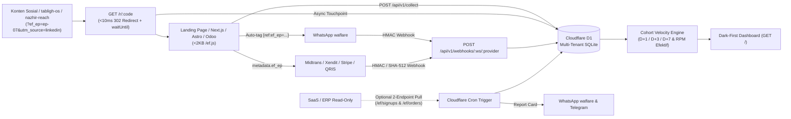

# edge-funnel

**100% Serverless First-Party Content Attribution & Same-Age Cohort Analytics Engine (`D+1` / `D+3` / `D+7`)** running on **Cloudflare Workers + D1 + Cron Triggers**.

Built to pass the **SAIF 10-Gate Productization Filter (`ZK-032`)**: **zero browser scraping**, `$0 Lock` serverless edge cost before scale, strict multi-tenant workspace isolation, and low *Idiot Index* integration for Indonesian & global payment ecosystems.

---

## Tesis: *Vanity Views vs Real Revenue*

Sebagian besar tim konten dan *creator* terjebak metrik semu (*vanity metrics*):

> *"Konten di Platform A meraih **100.000 views** tapi konversi bayar cuma **1%**, sedangkan Platform B hanya meraih **8.000 views** namun mencetak konversi bayar **8,8%** dengan tiket VIP 10x lebih tinggi."*

Masalah kedua yang sering menipu pengambilan keputusan adalah **bias umur konten**: membandingkan episode baru berumur 24 jam dengan akumulasi video lama yang sudah tayang 30 hari.

`edge-funnel` menyelesaikan dua masalah tersebut dengan tiga pilar:
1. **First-Party Attribution Tanpa Third-Party Cookie**: Smart redirect `<10ms` (`/r/:code`), skrip `<2KB` (`/ef.js`), *daily rotating visitor hash*, serta pelacakan *first-touch* vs *last-touch* hingga transaksi nyata (WhatsApp `waflare`, QRIS Dinamis, Midtrans, Xendit, Stripe).
2. **Evaluasi *Same-Age Cohort* (`D+1`, `D+3`, `D+7`)**: Membandingkan performa klik, *leads*, *paid*, dan **RPM Efektif** episode baru pada umur tayang tepat 24 jam (`D+1`), 72 jam (`D+3`), dan 168 jam (`D+7`) terhadap episode sebelumnya dan median 5 episode terakhir pada umur hari yang persis sama.
3. **2-Endpoint Contract & Integrasi Ekosistem**: Kompatibel langsung dengan standar parameter `ef_ep=<episode_code>` milik [`tabligh-os`](https://github.com/ridloabelian) dan `nazhir-reach`, serta mendukung Pull Sync read-only `/ef/signups` & `/ef/orders`.

---

## Arsitektur Edge



---

## Quickstart Lokal (`$0` di Edge Lokal)

Prasyarat: **Node.js >= 22** dan `npm`.

```bash
git clone https://github.com/ridloabelian/edge-funnel.git
cd edge-funnel
npm install

# Terapkan migrasi D1 lokal, isi data demo realistis (Vanity vs Revenue), dan jalankan di :8792
npm run demo
```

Buka dashboard di **`http://127.0.0.1:8792`**.

Demo seed langsung menyediakan 2 workspace terisolasi:
- `saif-growth` (API Key demo: `ef_demo_saif_key`) — 7 episode lintas TikTok, Instagram, YouTube, dan LinkedIn yang memperlihatkan kontras nyata antara *vanity reach* TikTok vs *high-converting* LinkedIn + breakout cohort `D+3` pada `ep-07`.
- `nazhir-reach` (API Key demo: `ef_demo_nazhir_key`) — 3 episode wakaf & dakwah kompatibel dengan `tabligh-os`.

---

## Kontrak Endpoint & Webhook Adapters

### 1. Edge Tracking Endpoints
- `GET /r/:code` — Smart redirect `<10ms`, otomatis menyuntikkan `ef_ep`, `utm_source`, `utm_medium`, `utm_campaign`, dan `ef_tp`, lalu mencatat klik secara asinkron via `ctx.waitUntil`.
- `GET /ef.js` — Vanilla JS `<2KB` (`data-ws="<workspace_slug>"`). Menyimpan `ef_vid`, `ef_ft` (*first-touch*), `ef_lt` (*last-touch*), mengirim beacon ke `POST /api/v1/collect`, dan otomatis menempelkan tag atribusi ke tautan `wa.me/`, `<form>`, serta `[data-ef-checkout]`.

### 2. Webhook Konversi Terautentikasi (`POST /api/v1/webhooks/:workspaceSlug/:provider`)

| Provider | Verifikasi Keamanan | Field Atribusi Otomatis |
| :--- | :--- | :--- |
| `waflare` | `x-waflare-signature` (HMAC-SHA256 raw body) | Regex `[ref:ef_ep=...|ft=...|vid=...]` dari teks pesan WA atau `metadata` |
| `qris` | `x-qris-signature` (HMAC-SHA256 raw body) | `metadata` / `additional_data` / `ref` |
| `midtrans` | Native `signature_key` (`SHA-512(order_id+status_code+gross_amount+server_key)`) | `custom_field1` (JSON/tag/code), `custom_field2/3`, `metadata` |
| `xendit` | `x-callback-token` atau `x-xendit-signature` (HMAC-SHA256) | `metadata.{ef_ep, ef_ft_ep, ef_vid}` |
| `stripe` | `stripe-signature: t=...,v1=...` (tolerance 300s + HMAC-SHA256) | `data.object.metadata.{ef_ep, ef_ft_ep, ef_vid}` |
| `generic` | `x-ef-signature` (HMAC-SHA256 raw body) | Payload top-level `ef_ep`, `ef_ft_ep`, `ef_vid`, `stage`, `amount`, `currency` |

### 3. 2-Endpoint Read-Only Pull Contract
Bagi aplikasi yang hanya ingin mengekspor JSON read-only:
- `GET /ef/signups?since=<ISO>` -> `lead` / `qualified`
- `GET /ef/orders?since=<ISO>` -> `paid`
Tersedia endpoint simulasi bawaan di `/demo-merchant/ef/signups` dan `/demo-merchant/ef/orders`.

### 4. Analytics & Multi-Tenant API
- `GET /api/v1/workspaces` & `POST /api/v1/workspaces`
- `GET /api/v1/workspaces/:slug/dashboard?model=last_touch|first_touch`
- `GET /api/v1/workspaces/:slug/cohorts?day=1|3|7&model=last_touch|first_touch`
- `POST /api/v1/workspaces/:slug/episodes` *(memerlukan header `x-ef-api-key`)*
- `POST /api/v1/workspaces/:slug/shortlinks` *(memerlukan header `x-ef-api-key`)*
- `POST /api/v1/workspaces/:slug/snapshots` *(memerlukan header `x-ef-api-key`)*
- `POST /api/v1/workspaces/:slug/pull-sync` *(memerlukan header `x-ef-api-key`)*
- `GET /api/v1/workspaces/:slug/reports/preview` & `POST /api/v1/workspaces/:slug/reports/dispatch`

---

## Integrasi `tabligh-os` & `nazhir-reach`

Saat `tabligh-os` atau `nazhir-reach` menerbitkan link distribusi konten, cukup sertakan `ef_ep=<episode_code>` bersama parameter UTM standar (atau arahkan ke shortlink `/r/<code>`):

```text
https://domainanda.id/wakaf-sumur?ef_ep=wakaf-sumur-01&utm_source=whatsapp&utm_medium=broadcast&utm_campaign=jumat-berkah
```

Lihat panduan integrasi lengkap untuk AI coding agents di [`skills/edge-funnel-integrate/SKILL.md`](skills/edge-funnel-integrate/SKILL.md).

---

## Deploy ke Cloudflare Workers (1-Klik Produksi)

```bash
# 1. Buat database D1 di Cloudflare dan salin database_id ke wrangler.toml
npx wrangler d1 create edge-funnel-db

# 2. Terapkan migrasi skema ke D1 remote
npm run db:migrate:remote

# 3. Deploy Worker + Cron Triggers
npm run deploy
```

Untuk rahasia global opsional, atur via `wrangler secret put EF_MASTER_API_KEY` (dan secret per workspace tetap tersimpan terisolasi di tabel `workspaces`).

---

## Pengujian & Verifikasi

```bash
npm run typecheck
npm test
```

## Lisensi

[MIT](LICENSE)
